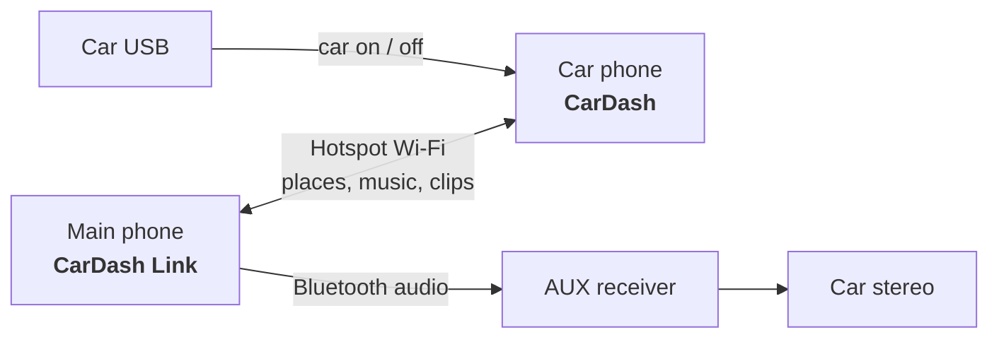

<div align="center">

&nbsp;&nbsp;&nbsp;&nbsp;

# CarDash

**Turn a spare Android phone into a car dashboard, with a companion app for your main phone.**

[](#-setup)
[](https://kotlinlang.org)
[](https://developer.android.com/compose)
[](https://developers.google.com/maps/documentation/navigation)
[](LICENSE)
[](https://ko-fi.com/crystaxit)

[Features](#-features) · [How it works](#-how-it-works) · [Setup](#-setup) · [Build](#-build-and-test) · [Support](#-support)

</div>

---

## 📦 What's inside

| | App | Runs on | What it does |
|:-:|---|---|---|
|  | **CarDash**<br>`app/` | The car phone (built for a OnePlus 5 on an Android 13 custom ROM, landscape) | The phone's home screen: map and turn-by-turn, music, dashcam, and car on/off routines |
|  | **CarDash Link**<br>`link/` | Your main phone (Android 12+, tested on Android 16) | Sends places to the car, mirrors your music, and brings dashcam clips to your phone |

`linkproto/` is the small protocol library both apps share. Both apps are sideloaded, not published.

## ✨ Features

### 🚗 CarDash

| | |
|---|---|
| 🔌 **Car on/off detection** | The charger (and optionally the car's Bluetooth) turns the car "on". "Off" waits until the signals have been gone for 20 s, to ride out the power dip while the engine cranks. |
| ▶️ **Car On routine** | Wi-Fi on (to join your phone's hotspot), Do Not Disturb, auto brightness, screen on, dashboard to the front, dashcam on, and music resumes. |
| ⏹️ **Car Off routine** | Pauses music, stops navigation and the dashcam, turns Wi-Fi off, shows a parked screen, then turns the screen off. |
| 🗺️ **Map and navigation** | Google map with in-app turn-by-turn (Navigation SDK) and place search with live suggestions. The map takes 60% of the screen, growing to 75% while a route runs. You can also navigate with Google Maps or Waze instead, or paste coordinates and Maps links. |
| 🎵 **Now playing** | This phone's player, or your main phone's music through Link, with play, pause and skip. |
| 🏠 **Home and Fav** | One tap to go home; Fav holds your saved places. |
| 🎥 **Dashcam** | Front or back camera, 3-minute clips, loop recording within a size limit, and a hard jolt locks the current clip. Sound is optional and off by default. |
| 🔋 **Charge limit** (root) | Pauses charging at 80% and resumes at 75%, to spare a battery that lives in a hot car. |
| 🌡️ **Heat alert** | Banner and notification when the battery gets hot. |
| 🌗 **Day/night theme** | Follows sunset at your GPS position. |

### 📱 CarDash Link

| | |
|---|---|
| 📍 **Send places to the car** | In Google Maps tap **Share → Send to car**, and the car starts the route. Short `maps.app.goo.gl` links are followed to the exact spot. Places shared while the car is away are queued until it connects. |
| 🔎 **Search, Home, Fav and recents** | Search from your phone with live suggestions. Searches run on the car phone's key, so your main phone needs none. |
| 🎶 **Music from your phone** | The car shows what's playing on your phone, through a Bluetooth AUX receiver for example, and controls it. Car Off pauses it; Car On resumes it once the car's audio is back. |
| 🎞️ **Dashcam clips** | Browse the car's clips by day, stream them with seeking, save them to your phone, and lock or delete them. |
| 🔒 **Paired and quiet** | Pair once with a 6-digit code. The link only runs while your hotspot is on. |

## 🔗 How it works



- Your main phone runs the hotspot, and the car phone joins it when the car turns on.
- The two apps log in to each other: each proves it holds the secret agreed at pairing.
- Dashcam videos stream straight from the car phone, using a key that changes on every connection.
- Nothing goes through the internet or any server.

## 🗝️ Google Maps API key

The map, in-app navigation and place search need a Google Maps Platform key with billing enabled. The free monthly allowances cover personal use. CarDash Link needs no key.

1. In Google Cloud, enable **Maps SDK for Android**, **Navigation SDK** and **Places API (New)**, then create an API key.
2. Restrict the key to Android apps (package `com.cardash.app` plus the SHA-1 of your signing key) and to those three APIs. Setting daily quota caps is also a good idea.
3. Add `MAPS_API_KEY=...` to `local.properties` in the project root. That file is git-ignored, so the key never reaches the repository.

> [!TIP]
> Without a key, CarDash still works: a speedometer replaces the map, and routes open in Google Maps or Waze.

## 🚀 Setup

### 1. Car phone

Factory-reset the phone and skip Google sign-in: Device Owner can only be set on a phone with no accounts. Enable USB debugging, plug it in, then run this from Git Bash:

```bash
./setup.sh --build
```

This installs CarDash, makes it Device Owner and the home screen, and grants its permissions. Afterwards you can sign in to Google and install Google Maps and YouTube Music.

### 2. Main phone

Enable USB debugging, plug it in, then run:

```bash
./setup-link.sh --build
```

### 3. Pair them

1. Turn on your main phone's hotspot and let the car phone join it.
2. In CarDash Link, tap **Pair**.
3. On the car phone, enter the code under **Settings → Phone link**.

> [!IMPORTANT]
> To remove CarDash, use **Settings → System → Release Device Owner…** on the car phone first. A Device Owner app can't be uninstalled until it's released.

## 🤔 Why some choices are unusual

- **Device Owner.** This lets CarDash:
  - remove the lock screen and turn the screen off;
  - toggle Wi-Fi and Bluetooth (blocked for normal apps since Android 10);
  - grant its own permissions;
  - pin itself as the home app;
  - start the dashcam from the background.
- **Root (Magisk)** is only used for the charge limit. On the OnePlus 5, pausing charging also cuts USB power, so the phone runs on battery while it holds at 80%.
- **Hotspot instead of the internet.** It's free, needs no server, and keeps your places and clips between your own two phones.

## 🛠️ Build and test

```bash
./gradlew assembleDebug testDebugUnitTest
```

The APKs end up in `app/build/outputs/apk/debug/` and `link/build/outputs/apk/debug/`. The unit tests cover:
- car on/off logic, the charge limiter and dashcam loop cleanup;
- sunrise/sunset times;
- coordinate and Google Maps link parsing;
- the link protocol, including pairing proofs, and HTTP byte ranges.

## 📜 Licence and attribution

CarDash is released under the [MIT License](LICENSE).

Maps, navigation and place search are provided by Google Maps Platform under its [Terms of Service](https://cloud.google.com/maps-platform/terms). Those SDKs are not open source. Both apps list their open-source licences in-app. The Lexend font is used under the SIL Open Font License; see [`licenses/Lexend-OFL.txt`](licenses/Lexend-OFL.txt).

## ☕ Support

If CarDash is useful to you, you can buy me a coffee on Ko-fi. Thank you!

<a href="https://ko-fi.com/crystaxit"></a>
